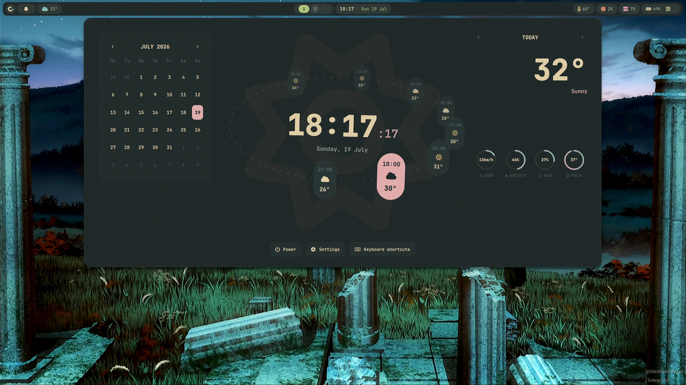
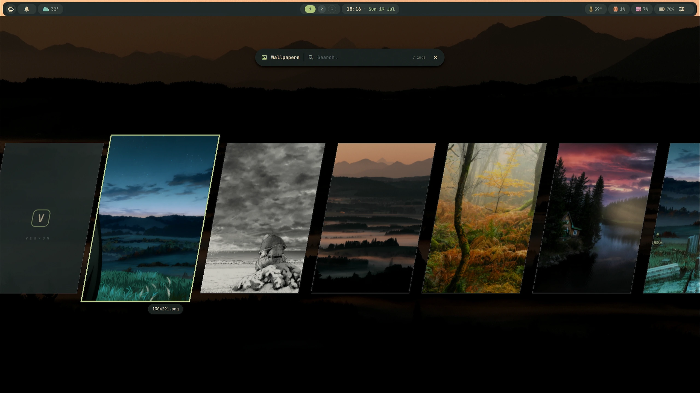

<div align="center">

# Vexyon Shell

**A from-scratch Wayland desktop shell for Hyprland — lightweight, fully themeable, and 100% configurable from the UI. No dotfiles required.**

[](CHANGELOG.md)
[](https://archlinux.org)
[](https://cachyos.org)
[](https://hypr.land)
[](https://quickshell.org)
[](https://wayland.freedesktop.org)

<br>


</div>

Vexyon is a complete desktop shell built from scratch in QML on [Quickshell](https://quickshell.org): bar, launcher, panels, settings, lock screen, OSD and even the login greeter are one cohesive, themed system — not a collection of separate tools. Everything is configured from the built-in Settings app; you never have to touch a config file.

---

## ✨ Showcase

<div align="center">
<table>
  <tr>
    <td align="center" width="50%">
      <br>
      <sub><b>Dashboard</b> — clock, calendar and weather with hourly forecast</sub>
    </td>
    <td align="center" width="50%">
      <br>
      <sub><b>Settings</b> — add, remove and reorder bar widgets from the UI</sub>
    </td>
  </tr>
  <tr>
    <td align="center" width="50%">
      <br>
      <sub><b>Wallpaper picker</b> — browse and search your wallpapers</sub>
    </td>
    <td align="center" width="50%">
      <br>
      <sub><b>Lock screen</b> — blurred wallpaper, themed clock and status pills</sub>
    </td>
  </tr>
</table>
</div>

---

## Features

- **100% configurable from the UI** — the Settings app covers wallpaper, themes, typography & motion, bar layout, keybinds, audio, network, displays and behavior. Changes apply live: a small bridge regenerates the Hyprland config and reloads it for you. No dotfile editing, ever.
- **Fully themeable** — 26 bundled themes (among them Catppuccin, Tokyo Night, Gruvbox, Rosé Pine, Kanagawa, Solarized, AMOLED, Crimson Voltage and the rest of Omarchy's set: Ethereal, Flexoki Light, Hackerman, Last Horizon, Lumon, Lupine, Matte Black, Miasma, Osaka Jade, Retro 82, Ristretto, Solitude, Vantablack, White) plus a theme store (which also has Nord and Everforest). The active theme drives the whole desktop: bar, panels, OSD, lock screen, greeter and even Hyprland window borders recolor instantly on switch.
- **Modular bar** — add, remove and reorder widgets per section: workspaces, clock, weather, media controls, focused window, system tray, CPU/RAM/temperature, battery, notifications and more.
- **Custom greetd greeter** — the login screen is part of the shell and stays in sync with your theme, language and keyboard layout.
- **Multimedia keys + themed OSD** — volume, brightness, mic mute and media keys work out of the box, with a clean bottom-center OSD that follows your theme. Event-driven (MPRIS and PipeWire handled in-process — no `playerctl`/`wpctl` spawning).
- **Dynamic iGPU pinning for hybrid laptops** — on iGPU + NVIDIA machines the session runs pinned to the iGPU; a udev hotplug handler re-decides on display hotplug, so plugging an external monitor wired to the dGPU works without reboot or re-login. No daemons, no polling.
- **Built-in everything** — app launcher, file manager, clipboard history, screenshot tool with region crop, notification center, quick settings, media / volume / network / battery / system-monitor panels, power menu and a keybind editor.
- **File manager (Super+E)** — copy, cut and paste go through the system clipboard, so they work between file manager windows and with other apps and file managers; your Desktop, Documents, Downloads, Pictures, Music and Videos folders at their real (also translated) paths; sidebar bookmarks you add with right-click → *Add to Sidebar* or by dragging a folder into the sidebar (the same bookmarks GTK file dialogs use); folder icons — a symbol on each user folder and a library of 260 symbols, or your own SVG/PNG, for any folder (right-click → *Customize Folder Icon*). It is also **the file chooser of every app**: a browser's *Upload*, *Save as*, GTK and portal apps and AirDrop open it instead of the GTK dialog.
- **Lock screen with PAM auth** — blurred wallpaper backdrop, themed clock, avatar and status pills (keyboard layout, battery, weather).
- **i18n** — English and Spanish, switchable live from Settings (dates, weather and all UI strings included).
- **Virtual machines** — a built-in VM manager (Super+V) on libvirt/QEMU: create, start, stop, snapshots, shared folders, TPM for Windows 11, OVA import/export, NAT/host-only/internal networks and a graphical display window. **Start with 3D acceleration** renders a Linux guest's graphics on the dedicated GPU (hybrid laptops) or on the main one when it already is the NVIDIA (MUX in dGPU mode, desktops): virtio-gpu with virgl, for that start only — the VM's saved definition is not changed. Windows guests have no 3D driver for it.
- **Screen recording (Super+R)** — record a whole screen (whatever workspace it shows), one window or a region; with system sound, the microphone, or both in one track; at native size or scaled to 1440p/1080p/720p, at the screen's rate or a fixed 60/30 fps.
- **Calculator (Super+Shift+C)** — a quick calculator on the focused screen; nothing runs while it is closed.
- **AirDrop** — send and receive files with nearby iPhones, iPads and Macs, from a bar button: visible for 10 minutes, an hour or until you turn it off, to everyone nearby (or, optionally, only to the Apple IDs you list in Settings); Apple devices see this computer under its **host name**. Received files land in your Downloads folder, go to the clipboard and show up in the notification center. Built on [omdrop-owl](https://github.com/t4t5/omdrop-owl) (AWDL through OWL, for Wi-Fi cards without Apple's chip) and [omdrop](https://github.com/netmojo-systems/omdrop-plugin); which Wi-Fi cards work is in [omdrop-owl's table](https://github.com/t4t5/omdrop-owl#supported-hardware), and Settings → AirDrop tells you about yours and checks every part, administrator access for the radio (pkexec) included. Nothing of it runs until you turn it on.
- **Optional modules, switched from Settings** — virtual machines, Bluetooth, screen recording and AirDrop are installed and on by default; turn off what you don't use in **Settings → Modules** and its background services stop starting. [More below](#optional-modules).
- **Lightweight by design** — event-driven services, timers that only run when their widget is on screen, minimal external dependencies.

## Requirements

- **Arch Linux** or **CachyOS** (Arch-based)
- **Hyprland** on Wayland

Vexyon is built to be installed on a **minimal base install** — the installer pulls in its own dependencies (Hyprland, Quickshell, greetd, etc.) via `pacman`.

For virtual machines the CPU's hardware virtualization (Intel VT-x or AMD-V/SVM) has to be turned on in the firmware (BIOS/UEFI) settings. That is the one thing no installer can do; Settings → Virtualization tells you if it is off.

## Installation

```bash
sudo pacman -S git
git clone https://github.com/vexyon/vexyon_shell.git
cd vexyon_shell
sudo chmod +x install.sh
./install.sh
sudo reboot
```

> **Note:** run `install.sh` as your normal user, **not** with sudo — it will ask for elevation only where needed. Only the `chmod` line uses sudo.

After the reboot, pick the **Vexyon** session at the greeter and you're in.

### What the installer sets up

Everything every feature needs — nothing has to be installed, enabled or edited by hand afterwards:

- **The desktop:** Hyprland, Quickshell, the greetd login screen, portals, polkit agent, PipeWire, fonts, cursors and the rest of the shell's dependencies.
- **Virtual machines:** `libvirt`, `qemu-desktop` (kept as is if you already have another QEMU), `virt-viewer`, `dnsmasq`, `swtpm`, `virtiofsd` and `edk2-ovmf`; the libvirt daemon (started at boot, then on demand), your user in the `libvirt` group, libvirt's default NAT network, — when Docker or ufw is installed — libvirt's iptables firewall backend so VMs keep their network, and — with the NVIDIA driver — the NVIDIA device nodes in libvirt's `cgroup_device_acl` (`/etc/libvirt/qemu.conf`), which 3D-accelerated VMs need.
- **Bluetooth:** `bluez` and its service (it only runs when an adapter is present).
- **Screen recording:** `wf-recorder`.
- **AirDrop:** [omdrop-owl](https://github.com/t4t5/omdrop-owl) built with `makepkg` from its own PKGBUILD at a pinned commit, so pacman owns it (`/usr/lib/omdrop`, its polkit action — no password from your own session —, a NetworkManager rule keeping its interfaces unmanaged and a `.link` file for `awdl0`); `makepkg -s` installs its dependencies from the official repositories. [omdrop](https://github.com/netmojo-systems/omdrop-plugin) 0.16.4 (pinned) in `/usr/local/lib/vexyon/plugins/omdrop`, with `omdrop` in `/usr/local/bin`; `git` and `base-devel` to build, `hostapd` (cards without ad-hoc mode) and `libheif` (iPhone photos to the clipboard). With ufw or firewalld active, one rule: TCP 8771 on `awdl0`, link-local peers only. If `brcmfmac-awdl-dkms` (the radio for Apple Silicon Macs) is installed, it is used instead of building omdrop-owl.
- **The rest:** `hyprpicker` (color picker), `pacman-contrib` (update counter), `libpulse` and `psmisc` (audio and privacy widgets), `xdg-user-dirs` (the file manager's user folders), NetworkManager enabled when nothing else manages the network.
- **File chooser and portals:** `python-gobject`; `vexyon-portal` and `vexyon-pick` in `/usr/local/lib/vexyon`, their D-Bus service and `vexyon.portal`, and `/etc/xdg/xdg-desktop-portal/hyprland-portals.conf` (file choosers → Vexyon, GTK as fallback) — only if that file does not exist yet or is Vexyon's; if it is yours the installer says so and leaves it. `/etc/systemd/user/vexyon-session.target`, which the shell starts at login to bring up `graphical-session.target` — `xdg-desktop-portal` 1.21 and later refuses to start without it, which broke every file chooser and screen share with *"startup job failed"*. See [File manager](#file-manager).
- **Settings → Modules:** a small root-owned helper (`/usr/local/lib/vexyon/vexyon-modules`), its polkit action, a boot unit (`vexyon-modules.service`) and one systemd drop-in per module service — see [Optional modules](#optional-modules).

Already-configured things are respected: a masked service stays masked, an existing libvirt setup with modular daemons is left alone, a `firewall_backend` or `cgroup_device_acl` you wrote is not touched, and NetworkManager is not enabled if another network manager is active. The installer does not create your user folders (`~/Desktop`, `~/Escritorio`…): the shell does, once, in its language — see [File manager](#file-manager).

### Updating

Pull and run the installer again. It is idempotent: it installs only what is missing, keeps your `shell.json` and every choice made in Settings (modules included), and never restarts your session.

```bash
cd vexyon_shell
git pull
./install.sh
```

## File manager

- **Clipboard.** Files you copy or cut are served by `wl-copy` (from `wl-clipboard`), so they stay on the clipboard after the file manager window closes and across a shell restart, until something else is copied. Like any Wayland clipboard, it ends with the session unless a clipboard manager keeps it. Pasting never overwrites: a name that already exists is skipped and the card offers **Keep both**; pasting into the same folder makes a copy named "name (copy)".
- **File chooser for every app.** When an app asks for a file or a folder through the desktop portal — a browser's *Upload*, *Save as*, GTK apps, Flatpaks — a Vexyon file manager window opens in pick mode: Open / Save / Select, the app's file-type filters, a name field when saving (replacing a file asks first), Esc or closing the window cancels. Behind it are `vexyon-portal`, an `xdg-desktop-portal` FileChooser backend started over D-Bus only when an app asks (it exits 30 s later), and `vexyon-pick`, which asks your running shell; the portal configuration puts it first for file choosers with `xdg-desktop-portal-gtk` as the fallback, used automatically when the shell is not running. The session exports `GTK_USE_PORTAL=1` so GTK 3 apps and Firefox go through the portal (Chromium-based browsers already do). AirDrop's *Change* folder button uses `vexyon-pick` directly.
- **User folders.** Created once, in the shell's language, when you close the welcome screen (where the language is picked): `Desktop`, `Documents`, `Downloads`… in English, `Escritorio`, `Documentos`, `Descargas`… in Spanish, plus the folders for wallpapers, screenshots and screen recordings inside them. Never again after that — not on an update, a rebuild or a reinstall — and never if `~/.config/user-dirs.dirs` already exists (your folders, from another desktop or an earlier Vexyon, stay as they are). A `~/.config/user-dirs.conf` with `enabled=False` stops `xdg-user-dirs-update` from recreating or renaming them at login; delete it if you want that tool back.
- **Where things are kept.** Bookmarks: `~/.config/gtk-3.0/bookmarks` (shared with GTK file dialogs, Nautilus and Thunar; lines Vexyon cannot show, like `sftp://`, are kept). Folder icons: `~/.local/share/vexyon/folder-icons.json` and, for your own images, a sanitised copy in `~/.local/share/vexyon/folder-icons/`. Nothing is written inside your folders.

## Optional modules

**Settings → Modules** lists the parts of Vexyon you can turn off. All of them are installed and **on** by default.

| Module | When it is off | Applies |
|---|---|---|
| **Virtual machines** | The VM manager and its bar widget are gone, and libvirt's services (`libvirtd`, `virtlogd`, `virtlockd`, `libvirt-guests` and their sockets) no longer start. | at the next restart |
| **Bluetooth** | The Bluetooth controls are gone and `bluetooth.service` no longer starts, so Bluetooth devices do not connect. | at the next restart |
| **Screen recording** | The recorder, its shortcut target, launcher entry and bar indicator are gone. It has no background service. | immediately |
| **AirDrop** | Its bar button, panel and Settings page are gone, and if this computer was visible the radio and the receiver stop. It has no background service: even on, nothing runs until you turn AirDrop on, and only for as long as you stay visible. | immediately |

- **Turning a module off never removes anything.** Packages stay installed; VMs, disks, networks, snapshots and Bluetooth pairings are kept. Turning it back on needs no download and no command — just the restart.
- **Nothing is stopped mid-session.** A module with services changes at the next boot, so a running VM or a connected headset is never pulled away. The card says "On until the next restart" while a change is pending.
- **System changes need your password once.** The switch asks through the normal polkit dialog; the only thing it can do is record that module choice.
- **Shared services are respected.** If other software you installed uses the same service — virt-manager or cockpit-machines for libvirt, GNOME, Plasma or Blueman for Bluetooth — that service keeps starting even with the module off; only Vexyon's part is hidden. The card names the software.
- **Always on:** the bar, launcher, panels, notifications, lock and login screens, wallpaper, clipboard history, night light, audio, networking and power. Tools like the calculator, screenshots, the color picker and the file manager run only while you use them.

---

<div align="center">

## Support & Socials

Follow the project, or help keep development going — every bit of support is genuinely appreciated 💚

<br>

[](https://www.tiktok.com/@vexyon.dev?is_from_webapp=1&sender_device=pc)
[](https://www.instagram.com/vexyon.dev/)
[](https://ko-fi.com/vexyon)

<sub>If Vexyon makes your desktop nicer, a coffee on Ko-fi is an optional but lovely way to support its development ☕</sub>

</div>
